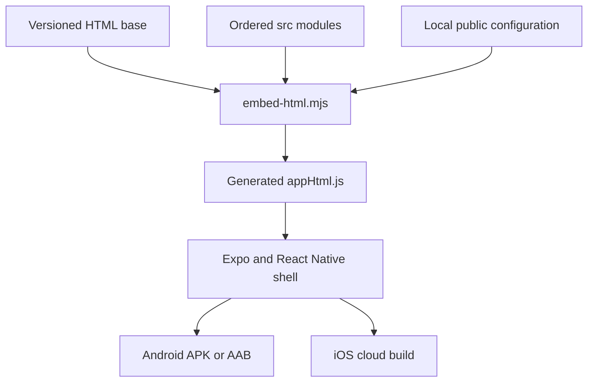
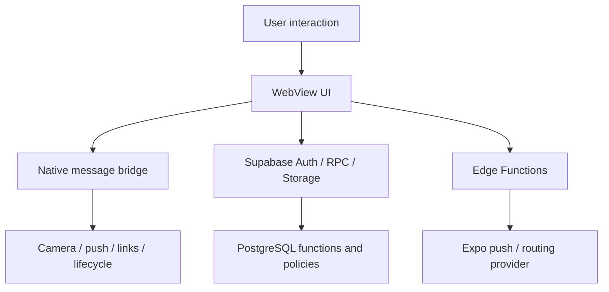

# Architecture and execution model

## Build-time flow

The embedding step first removes previously generated tagged sections, adds the selected modules in a fixed order, transforms browser prompt/confirm calls with the Babel-based dialog helper and inserts version metadata. It writes the versioned HTML and a generated JavaScript string export. Local public configuration is injected into the generated export, not into the committed HTML source. `src/publicConfig.js` is generated alongside it for the native push project ID.

The input HTML already contains embedded feature sections. This duplication is a current architectural constraint: edit the matching `src/` module, then run `npm run sync-html`; do not patch its generated section by hand. Refactoring to a base-only template and module bundler is a future change requiring visual and device regression testing.

## Runtime boundaries

The diagram is conceptual; not all data paths pass through an Edge Function. Nearby place discovery also calls public map data services from browser code. `src/realtime-v428.js` provides realtime hooks, while the polling scheduler coordinates periodic refresh work.

## Main modules

| Area | Files to start with |
| --- | --- |
| App shell and bridge | `App.js` |
| Auth/session | `src/sms-auth.js`, `src/quality-v428.js` |
| Polling/realtime | `src/polling-v427.js`, `src/realtime-v428.js` |
| Feed and reactions | `src/feed-v425.js`, `src/community-v447.js` |
| Conversations and attachments | `src/conversations-v429.js`, `src/chat-tools-v432.js`, `src/chat-storage-v425.js` |
| Compact UI/theme/calendar | `src/polish-v446.js`, `src/compact-v448.js` |
| Daily reminders | `src/daily-reminders-v431.js` |
| Marketplace and specialists | `src/market-v432.js`, `src/simplify-v444.js` |
| Community problems | `src/community-v434.js` |
| Administrator campaigns | `src/admin-campaigns-v4241.js`, `src/manage-v433.js` |
| Nearby discovery and routing | `src/locations-v430.js`, `src/routes-v449.js` |
| Native push retries | `src/push-registration-v442.mjs` |
| Content/account deletion | `src/deletion-v436.js`, deletion Edge Function |

Version suffixes record when modules were introduced; they do not mean that the app itself is that old version. The app version is checked across package metadata, Expo config, native Gradle configuration and build scripts.

## Backend source

| Function directory | Purpose / external configuration |
| --- | --- |
| `activity-push` | Notification delivery; uses server-side Supabase service credentials |
| `deletion-worker` | Cleanup worker; uses service credentials and worker authorization |
| `nearby-routes` | Walking/driving route matrix; `ORS_API_KEY` is server-side |
| `nearby-google` | Historical optional Google Places endpoint; `GOOGLE_PLACES_API_KEY` |

SQL patches cover content, campaigns, conversations, deletion, daily reminders, quotas, permissions and workflow changes. Some standalone files duplicate or aggregate migrations. Historical files containing payment/order logic do not establish that these functions are active in the current UI or in a deployed database.

## Trust boundaries

Client-side role checks are presentation only, never authority. Authorization must come from authenticated server functions and policies. An anon/publishable client key is public by design; a service-role key is privileged and must remain server-side. This package sanitizes project bindings, but does not certify deployed RLS policies.

The `tests/fixtures` files contain schema/function definition snapshots used by old tests. They are not a deployable database backup or evidence that the live server matches this source. No live backend was queried during this preparation.
